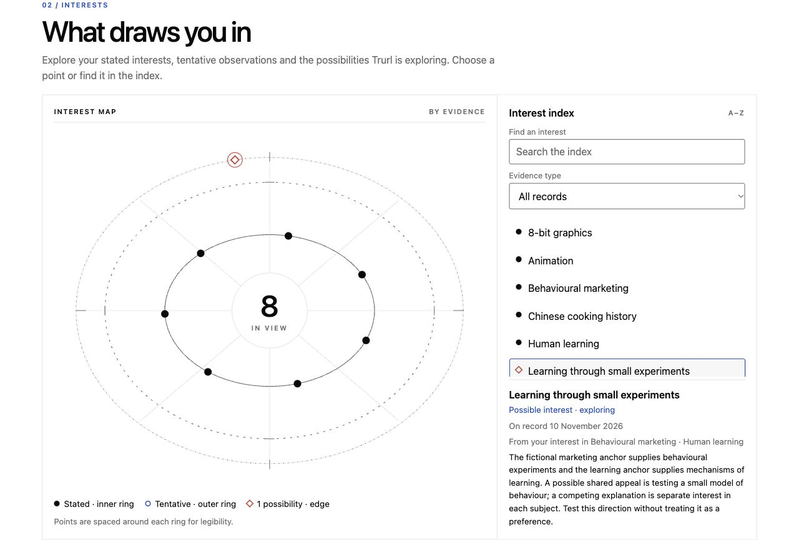
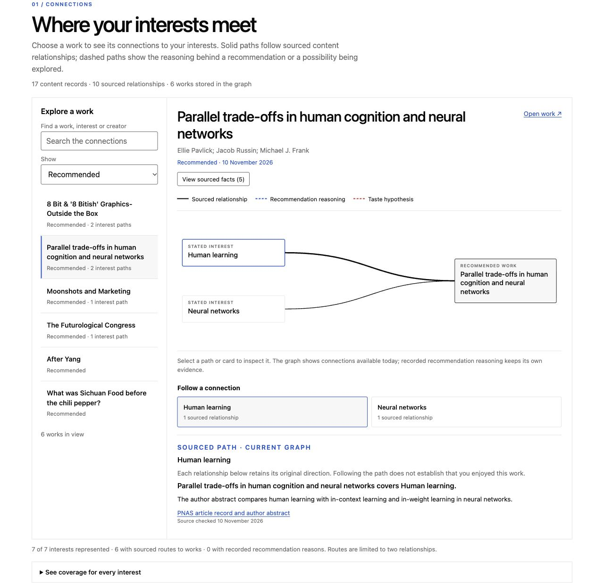
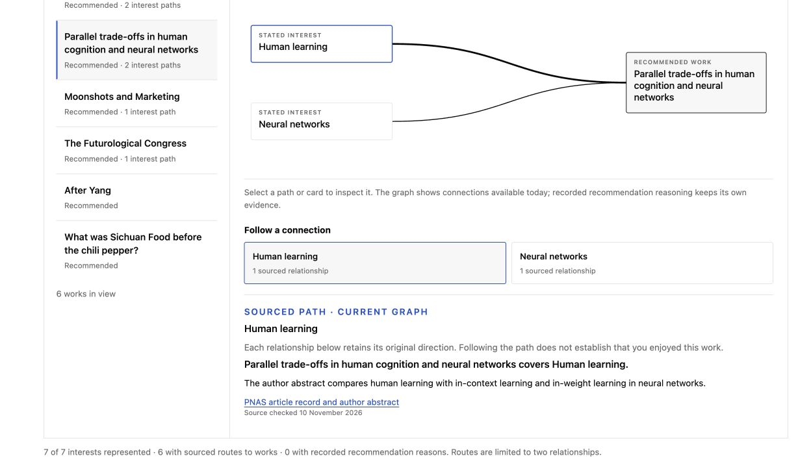
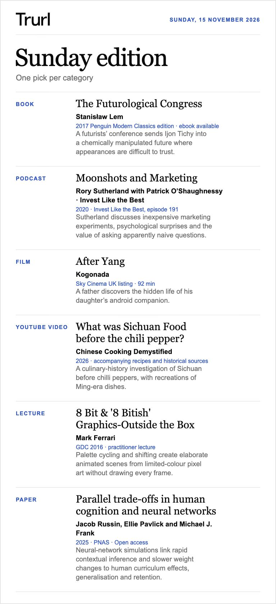

<p align="center">
  
</p>

# Trurl for Hermes

**Your agent, your taste.**

Trurl turns Hermes into a personal curator for books, films, podcasts, videos, lectures and papers. Start with one curiosity or share everything you like. It keeps a private, correctable taste model across sessions and uses actual feedback to refine future picks. Trurl uses seeded variation to explore different research directions and move beyond the same familiar recommendations. It is designed to counter **mode collapse**, an agent’s tendency to converge on predictable answers. It does that by broadening the search before checking each pick against your interests, constraints and reliable sources.

<p align="center">
  
  <br><sub>The native Taste Atlas, captured with a synthetic profile. Your own Atlas stays private.</sub>
</p>

The screenshots show actual HTML and SVG exports from Trurl **0.3.1**, using fictional interests and real example works. See the [capture details](assets/screenshots/capture-metadata.json) and [captions](assets/screenshots/CAPTIONS.txt).

- **Discover across themes.** Research can connect several interests through sourced relationships, with taste hypotheses kept tentative until feedback supports them.
- **Pick up where you left off.** Interests, delivered picks, scoped reactions and graph connections stay in your private Hermes profile.
- **Keep requests light.** A checked brief and complete interest index supply working context; Python reads the history locally for evidence checks and duplicates.
- **See the connection.** The interactive Taste Atlas separates sourced paths, recorded recommendation reasons and tentative possibilities.
- **Get straight to the work.** A linked title, creator and short description, or a designed Sunday edition across your chosen categories.

## Install

Use Hermes **0.23.0 or later**, **Python 3.11–3.14** and research tools. This source checkout vendors the shared engine from Trurl's fresh `main` commit `3e51e22a98195b5bd57614d19979af4b23b56375`; the [bundled provenance](engine/SOURCE.json) records its source and transformations. All required helpers and resources are included.

Download **`trurl.zip`** from the [0.3.1 release](https://github.com/oblomovunleashed/trurl-hermes/releases/tag/v0.3.1). For a fresh installation, extract it into the active Hermes profile's plugins directory and enable it:

```sh
mkdir -p "${HERMES_HOME:-$HOME/.hermes}/plugins"
unzip /absolute/path/to/trurl.zip -d "${HERMES_HOME:-$HOME/.hermes}/plugins"
hermes plugins enable trurl
```

The archive contains the `trurl/` runtime directory. Repository screenshots, artwork, tests, maintainer scripts and Git history are excluded.

The tagged **0.3.1** release is the original snapshot. This checkout includes later documentation and engine-provenance updates, with unchanged engine runtime code. The complete vendored engine and its license are included here; installation needs no access to a separate repository.

To build an install archive from a source checkout, run from the repository root:

```sh
trurl_release_dir="$(mktemp -d)/trurl-release"
python3 scripts/package_release.py --output "$trurl_release_dir"
```

Use the resulting `$trurl_release_dir/trurl.zip`. The runtime allowlist is [release-files.json](release-files.json); [source-files.json](source-files.json) separately covers the full reviewed repository. Maintainers can export that complete source with `--kind source`.

Preserve an existing profile's plugin data when updating. Start a new Hermes session and load the bundled skill as `trurl:trurl`, or ask Hermes to use Trurl.

> Build my taste profile. A mix of books, films and podcasts. I like comic science fiction, history and Chinese cooking. Use only what I share here.

One category and one anchor are enough. Relevant agent memory is optional; reviewing old chats is a separate choice. What you share now is enough to begin.

Try “A funny film for tonight”, “Find something connecting two of my interests”, “Something more unusual”, “I've already read that”, or “Show me my taste atlas”.

## A model that improves through evidence

Stated interests, observations, tentative hypotheses, familiarity, consumption and enjoyment remain distinct. New explicit interests can stand independently. Suggestions and graph paths do not establish taste; silence, clicks and completion do not prove enjoyment.

Trurl proactively checks for hypothesis maintenance after new interests, substantive feedback and before broad discovery. Hermes reviews original anchors and competing explanations, then records a proposal, review or reasoned no-proposal result. A paused request resumes with the same plan and seeds. Each researched pool also gets an explicit graph update review before selection, including an honest no-change outcome when sources support no relationship.

Every eligible interest is represented automatically in the graph. Sourced-route coverage is reported separately, so an isolated interest stays visible without invented links. Verified content relationships remain separate from personal preferences.

<p align="center">
  
  <br><sub>Select a work to inspect its sourced routes from your interests.</sub>
</p>

<details>
<summary>Inspect the source behind a connection</summary>

The source panel shows the evidence for the selected relationship, with a link to the source and the date it was checked.



</details>

### How it finds new fields

Trurl can suggest a field you haven’t thought to ask about. It actively reviews possible new interests after setup, when your interests or feedback change, and when broad discovery needs fresh possibilities. It looks within individual interests and across pairs of them, forming a tentative hypothesis about what else might appeal.

As a hypothetical example, liking Stanisław Lem and being curious about first-contact histories in Papua New Guinea might suggest an interest in how encounters challenge our assumptions. Trurl could test that idea with [*The Falling Sky*](https://www.jstor.org/stable/j.ctv34dm7q2) by Davi Kopenawa and Bruce Albert, an account of encounters with outsiders from a Yanomami perspective in the Amazon. The proposed connection concerns the limits of understanding; whether it explains your taste remains a hypothesis.

After Hermes researches recommendations, Trurl saves a small set of verified relationships between works, subjects and creators, with their sources attached. Each run records whether it added or revised facts, or found no supported changes. Here, the graph retains the book’s documented subject and authors, while the proposed connection to your enjoyment of Lem stays tentative in the taste model.

When a sourced content graph is available, Trurl can also find different interests leading to the same subject. It keeps a few of these converging routes as research leads; they do not automatically increase confidence about your taste. On a broad request, it can explore one promising connection through a recommendation that fits your constraints.

Feedback you choose to share helps it strengthen, narrow or reject the hypothesis and adjust what it looks for next. One enjoyed work leaves the broader idea tentative; clear confirmation or independently sourced enjoyment of distinct works can establish a supported interest. That gives future recommendations a richer starting point, with each new connection grounded in your reactions. You can inspect and correct these hypotheses at any time. [How taste hypotheses work](skills/trurl/references/taste-hypotheses.md)

For broader selections, seeded variation can change the research angles and the balance of priorities, helping Trurl look beyond the same few leads. Your requested format, time limits and exclusions still apply. Focused requests stay focused.

## Sunday edition

Choose your categories for one verified pick in each. The example for **Sunday, 15 November 2026** brings together Lem's satire, marketing experiments, an android's hidden life, Sichuan food history, pixel-art animation and human learning.

[](examples/sunday-2026-11-15/sunday-edition.md)

Open the [linked reading list](examples/sunday-2026-11-15/sunday-edition.md) or [original SVG](examples/sunday-2026-11-15/sunday-edition.svg).

Ask for an issue any time. Each edition uses your current plan and preferences, including categories, time budget and discovery settings. Genuine new-profile setup includes a disclosed Sunday proposal at **8 pm local time**, with an opportunity to say “one-off only”. Native schedule activation is verified before delivery is marked active. Existing profiles retain their choices. Every scheduled run stops before research when delivery is off.

## Native tools

| Tool | Purpose |
| --- | --- |
| `trurl_context` | Checked compact context, complete interest index and selective original-record reads. |
| `trurl_taste` | Explicit profile inspection and supplied interests, source choices or requested lasting settings. |
| `trurl_brief` | Evidence snapshots, freshness checks and a source-linked working brief. |
| `trurl_hypotheses` | Tentative proposals, evidence reconciliation and triggered maintenance/completion records. |
| `trurl_plan` | One retained scoring/discovery plan, resumed after due review without redrawing. |
| `trurl_graph` | Anchor representation, bounded fact reads and sourced post-research updates with completion records. |
| `trurl_select` | Checked preview and idempotent delivery after current maintenance and graph review. |
| `trurl_feedback` | Actual reactions and corrections with work, topic, creator, presentation or request scope. |
| `trurl_atlas` | Private interactive interest/activity and content Connections views. |
| `trurl_schedule` | Disclosed setup choices and verification of actual native Hermes jobs. |

The skill loads detailed references only when needed. Its support files are contained beneath the skill directory so Hermes's native `skill_view` can open them.

## Your data

Authoritative state lives in `trurl.sqlite3` under the active Hermes profile's plugin data directory. The tools report its location. It survives sessions and remains separate from installed code. Committed editions appear in `editions/`; requested Atlas output is `taste-atlas.html`.

Shared helpers operate on short-lived private snapshots. Graphs, anchor mappings and completion records return to the same SQLite transaction; the snapshots are removed afterward. The separate standalone taste model is never imported automatically.

Version **0.3.1** upgrades native state to schema 3 while retaining feedback wording, delivered records and existing version-2 preferences and delivery choices. Generated feedback-event locations remain available as record locators, but no longer count as evidence of independent original sources. Hypotheses affected by that correction become stale and need review before they can guide new picks. Historical scoring labels are recovered only when one matching saved batch selection establishes the original scoring basis.

Plugin runtime makes no direct network requests, launches no shell/background processes, and handles no credentials or telemetry. Hermes supplies research, model and scheduler capabilities under the session's permissions. Context returned by native tools is available to that session's configured model provider.

## The research behind Trurl

- **Broaden the search before ranking.** The agent starts with different leads, such as a museum archive for the history, a practitioner’s account or a paper on how something works. This borrows from research on getting models to propose a wider range of answers. [Verbalized Sampling](https://arxiv.org/abs/2510.01171)
- **Use seeds to vary the search.** Research on seed prompts helped inspire this. Trurl uses code for the draws, varying research directions and, on some requests, how much weight it gives to depth or novelty. With the same inputs, you can replay those draws. [String Seed of Thought](https://arxiv.org/abs/2510.21150) · [Large Language Models Are Bad Dice Players](https://arxiv.org/abs/2601.05414)
- **Follow connections you can check.** An optional knowledge graph gives the agent short, sourced paths between works, topics and creators. Each path gives it a lead to investigate. [Knowledge graph path reasoning](https://arxiv.org/abs/1906.05237)
- **Keep suggestions separate from taste.** Trurl keeps a record of what it recommended separately from what you say you liked. A coverage audit can show when the same subjects or creators keep turning up. [Recommendation feedback loops](https://arxiv.org/pdf/1710.11214) · [The Basic B\*\*\* Effect](https://arxiv.org/abs/2509.02910)

These studies inform the design. The notes explain what the studies tested and how to evaluate Trurl’s selections. [Research notes](docs/SCIENTIFIC_BASIS.md) · [Graph research](docs/GRAPH_RESEARCH.md)

## Local checks

```sh
python3 -m unittest discover -s tests -v
python3 scripts/package_release.py --check
python3 scripts/sync_engine.py --check-bundled
python3 scripts/sync_engine.py --source /path/to/trurl --check
hermes plugins doctor . --ci
hermes plugins validate . --install-deps
```

See [validation results](VALIDATION.md) for exact scope. Tests use synthetic state and isolated profiles. Doctor checks native loading and registration; `validate --install-deps` is the separate catalog admission check. These checks do not establish recommendation enjoyment or live scheduled delivery.

GitHub Actions runs the tests, bundled integrity checks and both archive builds on Python **3.11, 3.12, 3.13 and 3.14**. Full upstream re-sync verification additionally needs a clean checkout at the recorded commit; CI's bundled check works without access to the private upstream repository.

Catalog admission requires this public source repository to be pinned to an exact reviewed commit. Installation by catalog name becomes available after maintainer review and merge. Its vendored engine is included here, so users do not need access to the separate Trurl repository.

The maintainer-only sync script invokes local Git and writes deterministic engine/support projections during release preparation. It records the upstream commit and source hashes, performs no download, is not loaded by Hermes and accesses no private taste state. The installed plugin has no self-updater; catalog updates use reviewed SHA-bump PRs and Hermes's native plugin update command.

[Changelog](CHANGELOG.md) · [Hermes plugin development](https://hermes-agent.nousresearch.com/docs/developer-guide/plugins) · [Catalog submission](https://hermes-agent.nousresearch.com/docs/developer-guide/plugins/catalog-submission)
