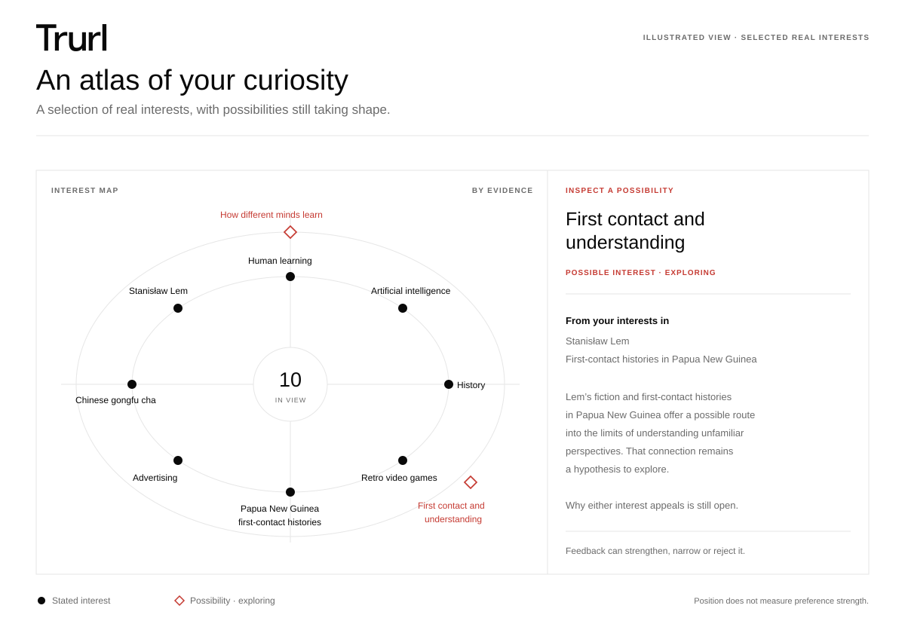
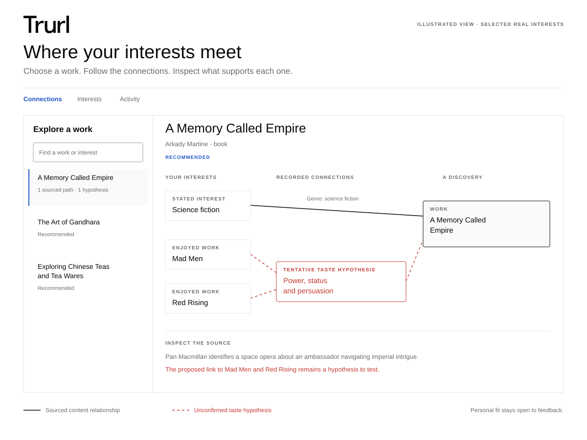

<p align="center">
  
</p>

# Trurl for Hermes

**Your agent, with taste.**

Trurl turns Hermes into a personal curator for books, films, podcasts, videos, lectures and papers. Start with one curiosity or share everything you like. It keeps a private, correctable taste model across sessions and uses actual feedback to refine future picks.

<p align="center">
  
  <br><sub>An illustration using approved example interests. Your own Atlas stays private.</sub>
</p>

- **Discover across themes.** Research can connect several interests through sourced relationships, with taste hypotheses kept tentative until feedback supports them.
- **Pick up where you left off.** Interests, delivered picks, scoped reactions and graph connections stay in your private Hermes profile.
- **Keep requests light.** A checked brief and complete interest index supply working context; Python reads the history locally for evidence checks and duplicates.
- **See the connection.** The interactive Taste Atlas separates sourced paths, recorded recommendation reasons and tentative possibilities.
- **Get straight to the work.** A linked title, creator and short description, or a designed Sunday edition across your chosen categories.

## Install

Use Hermes **0.23.0 or later** with research tools available. Version **0.3.1** bundles the shared engine pinned to the [Trurl repository](https://github.com/oblomovunleashed/trurl), commit `a63cf71900f85fefeb766c5ec051c1e22d11b697`. The required runtime helpers and resources are included, so installation does not require access to the upstream repository.

For a fresh installation, copy this folder containing `plugin.yaml` into the active Hermes profile's `plugins/trurl` directory, then enable it:

```sh
mkdir -p "${HERMES_HOME:-$HOME/.hermes}/plugins"
cp -R /absolute/path/to/trurl-hermes "${HERMES_HOME:-$HOME/.hermes}/plugins/trurl"
hermes plugins enable trurl
```

Preserve an existing profile's plugin data when updating. Start a new Hermes session and load the bundled skill as `trurl:trurl`, or ask Hermes to use Trurl.

> Build my taste profile. A mix of books, films and podcasts. I like comic science fiction, history and Chinese cooking. Use only what I share here.

One category and one anchor are enough. Relevant agent memory is optional; reviewing old chats is a separate choice. What you share now is enough to begin.

Try “A funny film for tonight”, “Find something connecting two of my interests”, “Something more unusual”, “I've already read that”, or “Show me my taste atlas”.

## A model that improves through evidence

Stated interests, observations, tentative hypotheses, familiarity, consumption and enjoyment remain distinct. New explicit interests can stand independently. Suggestions and graph paths do not establish taste; silence, clicks and completion do not prove enjoyment.

Trurl proactively checks for hypothesis maintenance after new interests, substantive feedback and before broad discovery. Hermes reviews original anchors and competing explanations, then records a proposal, review or reasoned no-proposal result. A paused request resumes with the same plan and seeds. Each researched pool also gets an explicit graph update review before selection, including an honest no-change outcome when sources support no relationship.

Every eligible interest is represented automatically in the graph. Sourced-route coverage is reported separately, so an isolated interest stays visible without invented links. Verified content relationships remain separate from personal preferences.

<p align="center">
  
</p>

## Sunday edition

Choose your categories for one verified pick in each. This preview was prepared on **9 November for Sunday, 15 November 2026**, bringing together Lem's satire, marketing experiments, an android's hidden life, Sichuan food history, pixel-art animation and human learning.

[](examples/sunday-2026-11-15/sunday-edition.md)

Ask for an issue any time. Genuine new-profile setup includes a disclosed Sunday proposal at **8 pm local time**, with an opportunity to say “No Sundays”. Native schedule activation is verified before delivery is marked active. Existing profiles retain their choices. Every scheduled run stops before research when delivery is off.

## Native tools

| Tool | Purpose |
| --- | --- |
| `trurl_context` | Checked compact context, complete interest index and selective original-record reads. |
| `trurl_taste` | Explicit profile inspection and supplied interests, source choices or requested lasting settings. |
| `trurl_brief` | Evidence snapshots, freshness checks and a source-linked working brief. |
| `trurl_hypotheses` | Tentative proposals, evidence reconciliation and triggered maintenance/completion records. |
| `trurl_plan` | One retained scoring/discovery plan, resumed after due review without redrawing. |
| `trurl_graph` | Anchor representation, bounded fact reads and sourced post-research updates with completion records. |
| `trurl_select` | Checked preview and idempotent delivery after current maintenance and graph review. |
| `trurl_feedback` | Actual reactions and corrections with work, topic, creator, presentation or request scope. |
| `trurl_atlas` | Private interactive interest/activity and content Connections views. |
| `trurl_schedule` | Disclosed setup choices and verification of actual native Hermes jobs. |

The skill loads detailed references only when needed. Its support files are contained beneath the skill directory so Hermes's native `skill_view` can open them.

## Your data

Authoritative state lives in `trurl.sqlite3` under the active Hermes profile's plugin data directory. The tools report its location. It survives sessions and remains separate from installed code. Committed editions appear in `editions/`; requested Atlas output is `taste-atlas.html`.

Shared helpers operate on short-lived private snapshots. Graphs, anchor mappings and completion records return to the same SQLite transaction; the snapshots are removed afterward. The separate standalone taste model is never imported automatically.

Version **0.3.1** upgrades native state to schema 3 while retaining feedback wording, delivered records and existing version-2 preferences and delivery choices. Generated feedback-event locations remain available as record locators, but no longer count as evidence of independent original sources. Hypotheses affected by that correction become stale and need review before they can guide new picks. Historical scoring labels are recovered only when one matching saved batch selection establishes the original scoring basis.

Plugin runtime makes no direct network requests, launches no shell/background processes, and handles no credentials or telemetry. Hermes supplies research, model and scheduler capabilities under the session's permissions. Context returned by native tools is available to that session's configured model provider.

## Local checks

```sh
python3 -m unittest discover -s tests -v
python3 scripts/sync_engine.py --source /path/to/trurl --check
hermes plugins doctor . --ci
hermes plugins validate . --install-deps
```

See [validation results](VALIDATION.md) for exact scope. Tests use synthetic state and isolated profiles. Doctor checks native loading and registration; `validate --install-deps` is the separate catalog admission check. These checks do not establish recommendation enjoyment or live scheduled delivery.

The maintainer-only sync script invokes local Git and writes deterministic engine/support projections during release preparation. It records the upstream commit and source hashes, performs no download, is not loaded by Hermes and accesses no private taste state. The installed plugin has no self-updater; catalog updates use reviewed SHA-bump PRs and Hermes's native plugin update command.

[Hermes plugin development](https://hermes-agent.nousresearch.com/docs/developer-guide/plugins) · [Catalog submission](https://hermes-agent.nousresearch.com/docs/developer-guide/plugins/catalog-submission)
