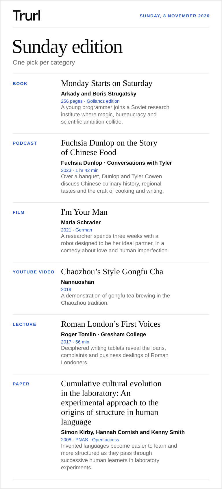

# Sunday edition

Sunday, 8 November 2026

## Book

**[Monday Starts on Saturday](<https://www.hachette.co.uk/titles/arkady-strugatsky/monday-starts-on-saturday/9781473202214/>)** · Arkady and Boris Strugatsky

256 pages · Gollancz edition

A young programmer joins a Soviet research institute where magic, bureaucracy and scientific ambition collide.

## Podcast

**[Fuchsia Dunlop on the Story of Chinese Food](<https://conversationswithtyler.com/episodes/fuchsia-dunlop-3/>)** · Fuchsia Dunlop · Conversations with Tyler

2023 · 1 hr 42 min

Over a banquet, Dunlop and Tyler Cowen discuss Chinese culinary history, regional tastes and the craft of cooking and writing.

## Film

**[I'm Your Man](<https://homecinema.curzon.com/film/im-your-man/>)** · Maria Schrader

2021 · German

A researcher spends three weeks with a robot designed to be her ideal partner, in a comedy about love and human imperfection.

## YouTube video

**[Chaozhou’s Style Gongfu Cha](<https://www.youtube.com/watch?v=fAl2Q-TJ254>)** · Nannuoshan

2019

A demonstration of gongfu tea brewing in the Chaozhou tradition.

## Lecture

**[Roman London’s First Voices](<https://www.gresham.ac.uk/watch-now/roman-londons-first-voices>)** · Roger Tomlin · Gresham College

2017 · 56 min

Deciphered writing tablets reveal the loans, complaints and business dealings of Roman Londoners.

## Paper

**[Cumulative cultural evolution in the laboratory: An experimental approach to the origins of structure in human language](<https://pmc.ncbi.nlm.nih.gov/articles/PMC2504810/>)** · Simon Kirby, Hannah Cornish and Kenny Smith

2008 · PNAS · Open access

Invented languages become easier to learn and more structured as they pass through successive human learners in laboratory experiments.
