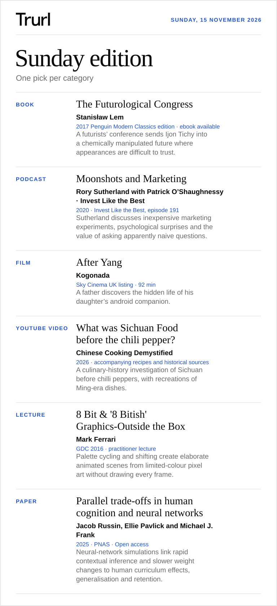

# Sunday edition

Sunday, 15 November 2026

Preview prepared on request on 9 November 2026.

## Book

**[The Futurological Congress](<https://www.penguin.co.uk/books/305868/the-futurological-congress-by-lem-stanislaw/9780241312797>)** · Stanisław Lem

2017 Penguin Modern Classics edition · ebook available

A futurists’ conference sends Ijon Tichy into a chemically manipulated future where appearances are difficult to trust.

## Podcast

**[Moonshots and Marketing](<https://colossus.com/episode/sutherland-moonshots-and-marketing/>)** · Rory Sutherland with Patrick O’Shaughnessy · Invest Like the Best

2020 · Invest Like the Best, episode 191

Sutherland discusses inexpensive marketing experiments, psychological surprises and the value of asking apparently naive questions.

## Film

**[After Yang](<https://www.sky.com/watch/programme/fdd5b220-e3d1-4436-ab17-61ebdc34c9be>)** · Kogonada

Sky Cinema UK listing · 92 min

A father discovers the hidden life of his daughter’s android companion.

## YouTube video

**[What was Sichuan Food before the chili pepper?](<https://www.youtube.com/watch?v=tsuSylVVx2w>)** · Chinese Cooking Demystified

2026 · accompanying recipes and historical sources

A culinary-history investigation of Sichuan before chilli peppers, with recreations of Ming-era dishes.

## Lecture

**[8 Bit \& '8 Bitish' Graphics-Outside the Box](<https://www.youtube.com/watch?v=aMcJ1Jvtef0>)** · Mark Ferrari

GDC 2016 · practitioner lecture

Palette cycling and shifting create elaborate animated scenes from limited-colour pixel art without drawing every frame.

## Paper

**[Parallel trade-offs in human cognition and neural networks](<https://pmc.ncbi.nlm.nih.gov/articles/PMC12415290/>)** · Jacob Russin, Ellie Pavlick and Michael J. Frank

2025 · PNAS · Open access

Neural-network simulations link rapid contextual inference and slower weight changes to human curriculum effects, generalisation and retention.
